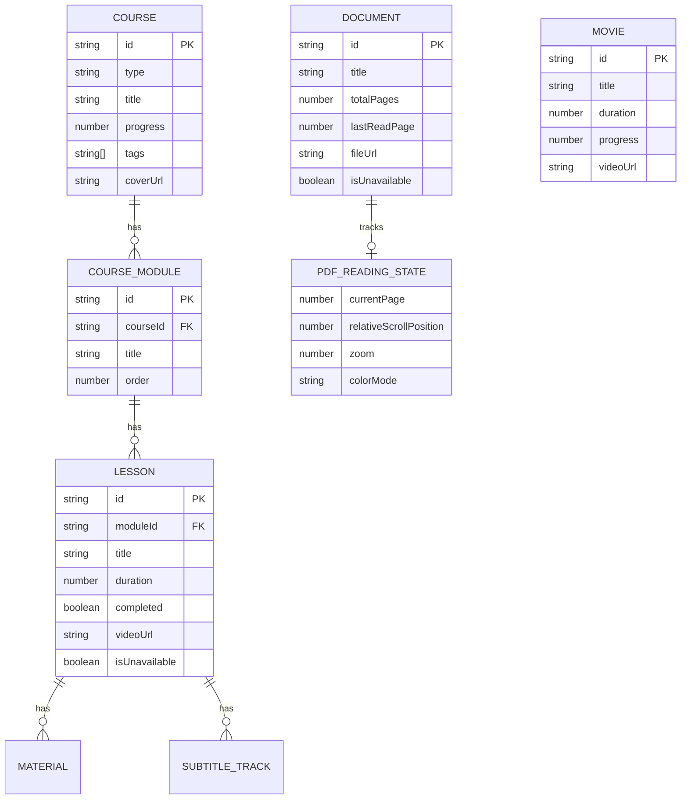

# Modelo de Domínio — midoteca-desktop (frontend)

> Os tipos do frontend vivem em `client/src/core/domain/library.ts`. Este documento
> descreve os conceitos, os view-models e a relação com o domínio canônico do
> núcleo (`midoteca/src/core` hoje; alvo `midoteca/src/modules/<contexto>/domain` —
> ver [`../../docs/ARCHITECTURE.md`](../../docs/ARCHITECTURE.md) §12).

## 1. Conceitos

- **`LibraryItem`** — união `Course | Movie | Document` (o que aparece no catálogo).
- **`Course` / `CourseModule` / `Lesson`** — estrutura lógica de um curso.
- **`Movie`** — vídeo standalone (sem curso).
- **`Document`** — PDF lógico com estado de leitura.
- **`Material`** — anexo de uma aula (pdf/code/link/note).
- **`SubtitleTrack`** — faixa de legenda (com conteúdo VTT/SRT mockado).
- **`PdfReadingState`** — página, rolagem relativa, zoom e modo de cor.
- **`SearchResult` / `SearchFilter`** — resultado e filtro da busca universal.
- **`NavigationTab`** — abas da shell (`home`, `library`, `course-details`,
  `player`, `search`, `settings`, `editor`, `pdf-viewer`).

## 2. Diagrama



## 3. View-models x domínio canônico

Os tipos do frontend carregam **campos de apresentação** (`coverUrl`, `tags`,
`progress`, `lastPlaybackPosition`, `isUnavailable`). Esses são **view-models** e
pertencem à camada de aplicação/UI.

O domínio canônico vive no núcleo (`midoteca/src/core`):

| Frontend (view-model)               | Núcleo (canônico)                                                  |
| ----------------------------------- | ------------------------------------------------------------------ |
| `Course`                            | `Course` + `CourseModule` + `Lesson` (`core/courses`)              |
| `Lesson.videoUrl` / `isUnavailable` | `MediaFile` + `LessonMedia` (`core/media`)                         |
| `Lesson.lastPlaybackPosition`       | `PlaybackProgress` (`core/progress`)                               |
| `Document` / `PdfReadingState`      | `Document` + `ReadingProgress` (`core/documents`, `core/progress`) |
| `SearchResult`                      | contrato de busca (`core/search`)                                  |

Regra: campos de apresentação **derivam** do canônico (via adapter) e nunca
viram chave/identidade. `Course.metadata` (JSON) é o ponto de extensão no núcleo
para tags/cover sem alterar o esquema SQLite.

## 4. Ports (contratos)

Em `services/contracts.ts`:

### `LibraryCatalogRepository`

```ts
getItems(type?): LibraryItem[];
getItemById(id): LibraryItem | undefined;
getCourseById(id): Course | undefined;
getDocumentById(id): Document | undefined;
saveCourse(course): Course;                       // persiste e notifica
toggleLessonCompletion(courseId, lessonId): Course | undefined;
subscribe(listener): () => void;                  // cancelável
```

### `PlaybackStateRepository`

```ts
savePlaybackPosition(courseId, lessonId, positionSeconds): void;
getPlaybackPosition(courseId, lessonId): number;
saveSubtitlePreference(courseId, lessonId, subtitleId | null): void;
getSubtitlePreference(courseId, lessonId): string | null;
addCustomSubtitle(courseId, lessonId, subtitle): void;
```

### `ReadingStateRepository`

```ts
getDocumentReadingState(docId): PdfReadingState;
saveDocumentReadingState(docId, state): void;
setDocumentUnavailable(docId, unavailable): void;
```

### `PageProvider`

```ts
fetchPageRange(docId, startPage, endPage): Promise<PdfPageChunk[]>;
```

### `ISearchService`

```ts
search(query, filter): SearchResult[];
```

### `LibraryRepository`

Agregado: `LibraryCatalogRepository & PlaybackStateRepository &
ReadingStateRepository & PageProvider & ISearchService`.

## 5. Regras de modelagem

- Mutações de **catálogo** notificam assinantes; mutações de **estado de
  reprodução/leitura** não (por contrato).
- `isUnavailable` representa arquivo indisponível (HD desconectado) sem remover
  o item — espelha `availability = 'missing'` do núcleo.
- Progresso é 0–100 no view-model; no núcleo é posição/duração em ms.
- Nada de caminho absoluto como identidade (ver
  [`../../midoteca/docs/FILE_IDENTITY.md`](../../midoteca/docs/FILE_IDENTITY.md)).
