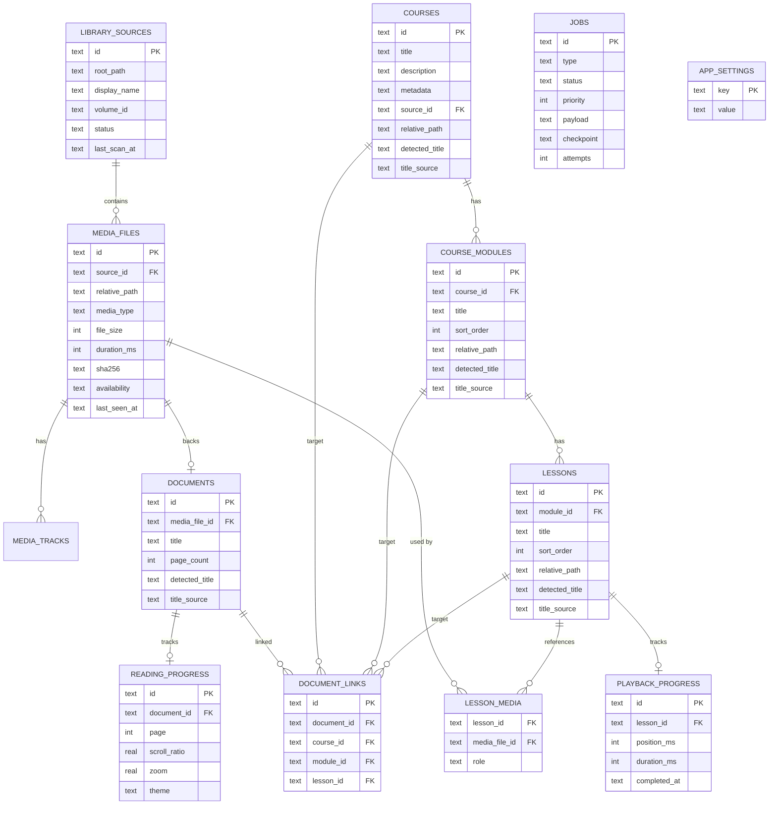

# Modelo de Domínio — Midoteca (Fases 1–2)

## 1. Conceitos

O domínio separa explicitamente **arquivos físicos** de **conteúdos lógicos**:

- **`LibrarySource`** — uma raiz de armazenamento (ex.: HD externo).
- **`MediaFile`** — um arquivo físico dentro de uma fonte (vídeo, PDF, ...).
- **`Course` / `CourseModule` / `Lesson`** — a estrutura lógica de um curso.
- **`LessonMedia`** — o vínculo N:N entre aulas e arquivos.
- **`Document` / `DocumentLink`** — um PDF lógico e seus vínculos.
- **`PlaybackProgress` / `ReadingProgress`** — progresso ancorado em aula/documento.
- **`Job`** — trabalho de segundo plano persistido.
- **`AppSetting`** — preferências chave/valor.

## 2. Diagrama de entidades



## 3. Regras de modelagem aplicadas

- Identificadores **UUID persistentes**; caminhos nunca são chave primária.
- Arquivos físicos separados de conteúdos lógicos.
- Uma aula pode referenciar **vários** arquivos (papéis distintos).
- Progresso **independente do arquivo físico** (ancorado em aula/documento).
- Constraints e foreign keys explícitas; comportamento de exclusão definido.
- Cascatas só removem catálogo; nunca arquivos.
- `sha256` sem unicidade global (dedup é permitida).
- `DocumentLink` valida que ao menos um destino (curso/módulo/aula) existe.
- Espaço reservado para fingerprint: `media_files.sha256` + `media_tracks.metadata`.

### Proveniência de título (Fase 2)

- `title_source` ∈ {`detected`, `manual`, `manifest`} registra a origem do
  título. Precedência: **manual > manifest > detected**.
- Um rescan **nunca** sobrescreve um título `manual`.
- `detected_title` guarda sempre o último título derivado do sistema de arquivos.
- `source_id` + `relative_path` dão identidade de origem a cursos/módulos/aulas,
  evitando duplicação em reescaneamentos (índices únicos parciais).
- `media_files.last_seen_at` guarda o token da execução que observou o arquivo;
  arquivos não vistos viram `availability = 'missing'` (sem deleção).
- `library_sources.display_name` é um rótulo amigável independente do caminho.

### Ajustes em relação ao esboço do enunciado

| Enunciado                        | Implementado                             | Justificativa                                      |
| -------------------------------- | ---------------------------------------- | -------------------------------------------------- |
| entidade `Module`                | `CourseModule` (tabela `course_modules`) | evitar colisão com o conceito de módulo ES/Node    |
| `Document` sem timestamps        | idem (sem timestamps)                    | segue o esboço; sem necessidade de auditoria ainda |
| `Module`/`Lesson` sem timestamps | idem                                     | mantém o esboço mínimo, sem campos especulativos   |

## 4. Contratos de repositório

Os contratos vivem em `core/*/repository.ts` e são implementados em
`infra/sqlite/repositories/*`. Eles **não** referenciam tipos de framework.

### LibraryRepository

```ts
createSource(input: CreateLibrarySource): Promise<LibrarySource>;
findSourceById(id): Promise<LibrarySource | null>;
findSourceByVolumeId(volumeId): Promise<LibrarySource | null>;
findSourceByRootPath(rootPath): Promise<LibrarySource | null>;   // Fase 2
listSources(): Promise<LibrarySource[]>;
updateSourceStatus(id, input): Promise<LibrarySource | null>;
updateSourcePath(id, input): Promise<LibrarySource | null>;       // Fase 2
deleteSource(id): Promise<void>;                 // catálogo apenas
```

### MediaRepository

```ts
create(input): Promise<MediaFile>;
findById(id): Promise<MediaFile | null>;
findBySourceAndRelativePath(sourceId, relativePath): Promise<MediaFile | null>;
listBySource(sourceId): Promise<MediaFile[]>;
findBySha256(sha256): Promise<MediaFile[]>;       // múltiplos resultados
update(input): Promise<MediaFile>;
setAvailability(id, availability): Promise<void>;
delete(id): Promise<void>;                        // catálogo apenas
addTrack(input): Promise<MediaTrack>;
listTracks(mediaFileId): Promise<MediaTrack[]>;
deleteTrack(id): Promise<void>;
```

### CourseRepository

```ts
create/findById/list/update/delete;
findBySourceAndPath(sourceId, relativePath);        // Fase 2
listBySource(sourceId);                             // Fase 2
createModule/listModules;
createLesson/findLessonById/listLessons;
attachMedia/listLessonMedia/detachMedia;
getTree(courseId): Promise<CourseTree | null>;    // agregado transacional
```

### DocumentRepository

```ts
create/findById/findByMediaFileId/list/delete;
createLink/listLinks/deleteLink;
```

### ProgressRepository

```ts
savePlayback(input): Promise<PlaybackProgress>;   // upsert por aula
getPlayback(lessonId): Promise<PlaybackProgress | null>;
saveReading(input): Promise<ReadingProgress>;      // upsert por documento
getReading(documentId): Promise<ReadingProgress | null>;
```

### JobRepository

```ts
enqueue/findById/listByStatus/update/delete;
```

### SettingsRepository

```ts
get(key) / set(key, value) / list() / delete key;
```

## 5. Entrada, saída e erros

- **Entradas** (`core/*/inputs.ts`) são tipos de comando com `id?` opcional
  (permite ids determinísticos em testes/seeds) e campos opcionais onde faz
  sentido.
- **Saídas** são as entidades de domínio (`core/*/entities.ts`), sem tipos do
  driver.
- **Validação** ocorre na borda do repositório (`core/shared/validation.ts`),
  lançando `ValidationError` antes de tocar o banco.
- **Erros** (`core/shared/errors.ts`): `MidotecaError` →
  `NotFoundError`, `ValidationError`, `ConflictError`, `PersistenceError`. O
  driver SQLite é mapeado por `infra/sqlite/errors.ts`.

## 6. Compatibilidade com o client

O client (`client/src/types/library.ts`) modela `Course`, `Document` e `Lesson`
com campos de apresentação (cover, tags, progresso, `lastPlaybackPosition`).
Esses campos são **view-model** e pertencem à camada de aplicação/UI; o domínio
guarda apenas dados canônicos. `Course.metadata` (JSON) é o ponto de extensão
para tags/cover sem alterar o esquema. O contrato de busca em `core/search` já
espelha `SearchResultKind`/`SearchFilter` do client para futura ligação real.

A fronteira frontend↔backend (ports no FE, casos de uso no núcleo) está descrita
em [`../../docs/ARCHITECTURE.md`](../../docs/ARCHITECTURE.md) e
[`../../docs/DDD_GUIDELINES.md`](../../docs/DDD_GUIDELINES.md).
